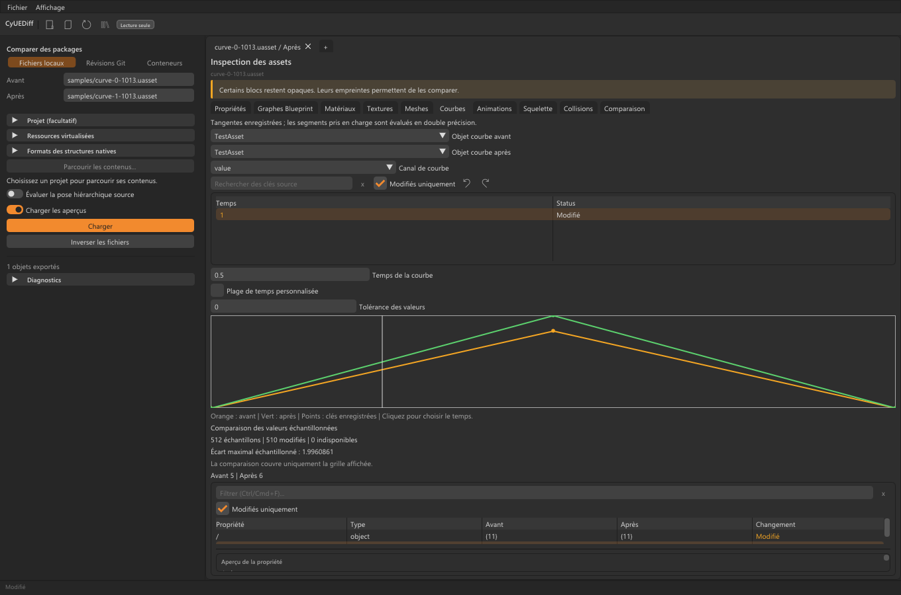
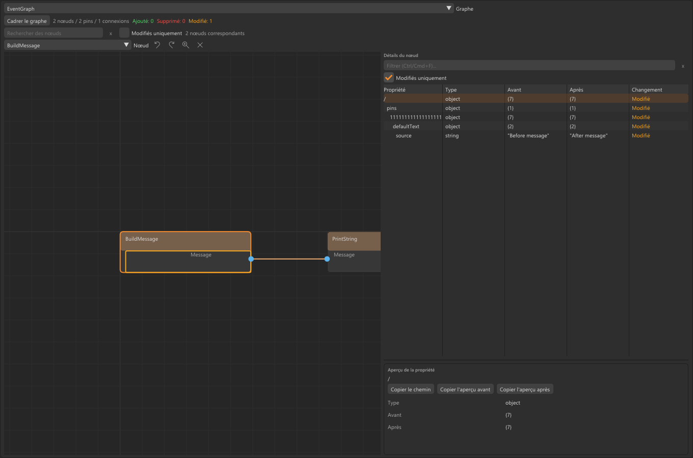
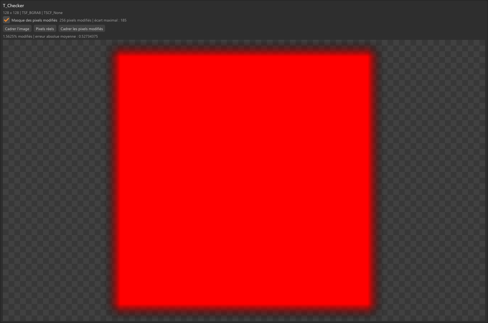

<table width="100%">
  <tr>
    <td width="300" align="left" valign="top">
      <a href="https://mrmybal.github.io/CyUEDIFF/?lang=fr">Présentation</a><br>
      <a href="https://mrmybal.github.io/CyUEDIFF/guide.html?lang=fr#start">Manuel</a><br>
      <a href="https://github.com/MrMybal/CyUEDIFF">GitHub</a><br><br>
      <sub>README</sub><br>
      <a href="README.md">English</a> · <a href="README.fr.md">Français</a>
    </td>
    <td width="400" align="center" valign="middle">
      <a href="https://mrmybal.github.io/CyUEDIFF/?lang=fr"></a>
    </td>
    <td width="300" align="right" valign="top">
      <p><sub>Licence de l’application</sub><br><a href="LICENSE"><strong>MIT</strong></a></p>
      <p><sub>Version des sources</sub><br><a href="VERSION.fr.md"><strong>0.181.0</strong></a><br><strong>EN DÉVELOPPEMENT</strong></p>
      <p><sub>Application Windows x64<br>Aucune release publique de l’application</sub></p>
    </td>
  </tr>
</table>

<h1 align="center">CyUEDiff</h1>

Inspectez les assets Unreal Engine et comprenez ce qui change **sans lancer Unreal Editor**. CyUEDiff propose une application Windows, un outil en ligne de commande JSON et un lecteur C++17 réutilisable pour les développeurs Unreal, les artistes techniques et les créateurs d’outils.

> **EN DÉVELOPPEMENT · 0.181.0**
>
> Cette version des sources propose une couverture des formats explicite et évolutive. Les données inconnues conservent leurs diagnostics et empreintes binaires. Consultez les [notes de version, plateformes prises en charge et limites connues](VERSION.fr.md) avant de choisir votre méthode de travail.

[](site/assets/screenshots/overview-fr.png)

## L’application

Ouvrez un asset ou comparez deux versions, puis passez des propriétés typées aux graphes Blueprint et de matériau, textures, meshes sources, collisions, squelettes, clés d’animation et courbes. Recherchez une propriété ou un nœud, inspectez ses valeurs enregistrées et suivez les changements surlignés. Chaque côté peut utiliser son propre contexte de projet, moteur et schéma.

Examinez des packages libres `.uasset` / `.umap` avec leurs fichiers compagnons, des révisions Git locales avec un contenu LFS local vérifié ou des membres Pak/IoStore pris en charge. Gardez jusqu’à huit documents ouverts et enregistrez des espaces de travail explicites avec les sélections, filtres, navigations et proportions des panneaux pris en charge. L’anglais est la langue par défaut ; le français est intégré. Les noms d’assets et valeurs sérialisées conservent leur langue d’origine.

<table>
  <tr>
    <td width="50%"><a href="site/assets/screenshots/blueprint-fr.png"></a><br>Graphe Blueprint d’éditeur et nœud sélectionné</td>
    <td width="50%"><a href="site/assets/screenshots/textures-fr.png"></a><br>Comparaison de textures sources et pixels modifiés</td>
  </tr>
</table>

Ces captures réelles de l’application et des composants CyUI intégrables utilisent des données de démonstration originales générées. Cliquez sur une image pour l’ouvrir à sa taille complète. La [vitrine](https://mrmybal.github.io/CyUEDIFF/?lang=fr) présente d’autres vues.

## Fonctionnalités

- **Différences d’assets lisibles** : propriétés typées consultables par recherche, références d’objets stables, textes structurés des pins Blueprint, graphes de matériau et paramètres d’instance enregistrés, avec une couverture partielle ou opaque explicitée.
- **Inspection des images et géométries sources** : sources et mips Texture2D LDR/HDR pris en charge, différences de pixels/échantillons, filaires MeshDescription modernes, différences de géométrie et export OBJ de la géométrie de base. Les os sources modernes, profils de poids bruts et deltas de morph nommés sont validés sur des jeux de test synthétiques.
- **Données de mouvement enregistrées** : poses de référence/retarget des squelettes, sockets, clés d’animation locales prises en charge, origines de joints/sockets sources liées à un Skeleton explicite et rich curves avec évaluation pondérée prise en charge. Ces vues inspectent les données sources enregistrées.
- **Contexte de projet et de révision** : racines de projet et moteur distinctes avant/après, historique Git et contenu LFS locaux, membres Pak 10/11 et IoStore TOC 3–5 pris en charge, tables Zen cooked et propriétés USMAP associées explicitement.
- **Lecteurs extensibles** : callbacks natifs bornés et descriptions binaires déclaratives avec profils de version explicites ; les magasins locaux de payloads d’éditeur virtualisés exigent une vérification BLAKE3 complète des octets bruts. Le chargement propose une annulation coopérative, une progression et un cache de packages vérifié.
- **Deltas de blocs réutilisables** : génération, composition et reconstruction de différences de fichiers/blocs avec vérification SHA-256. Cette API de reconstruction binaire est distincte ; l’hébergement distant des objets et leur synchronisation ne sont pas implémentés.

### Utiliser le moteur dans une autre application

| Composant | Rôle |
| --- | --- |
| `CyUEDiff::Core` | Lecteurs de packages/conteneurs, snapshots, différences spécialisées et reconstruction binaire ; indépendant d’Unreal Editor, de Git et de CyUI. |
| `CyUEDiff::Git` | Accès optionnel aux révisions locales et au contenu LFS vérifié. Nécessite Git 2.45+. |
| `CyUEDiff::UI` | Vues CyUI intégrables séparées pour les propriétés, graphes, images et géométries, compilées depuis les sources avec l’hôte. |
| `cyuediff` / `cyuediff_desktop` | CLI JSON et hôte Windows optionnel. |

Liez `CyUEDiff::Core` avec `add_subdirectory`, ou installez le SDK et utilisez `find_package(CyUEDiff CONFIG REQUIRED)`. Commencez par l’[exemple Core](examples/consumer/) et l’[exemple des morphs sources](examples/mesh_morph_consumer/). Le SDK installé fournit le Core et l’adaptateur Git sélectionné ; l’intégration UI utilise le dépôt des sources. Voir l’[architecture](docs/ARCHITECTURE.md) et l’[intégration UI](docs/UI.md).

---

## Installation

**Aucune release publique de l’application n’est encore disponible.** Compilez les sources avec les instructions ci-dessous. Les builds Core/CLI passent la CI hébergée sur Windows 2022 et Ubuntu 24.04, avec et sans Git. L’application est vérifiée localement sur Windows x64 avec Direct3D 11 ; aucun build desktop Linux ou macOS n’est proposé.

Les builds Windows utilisant le runtime MSVC dynamique par défaut nécessitent le runtime Microsoft Visual C++ x64 correspondant. Les fonctions Git nécessitent une installation séparée de Git 2.45+ ; l’inspection de fichiers libres n’en dépend pas. Conservez les archives CPack extraites avec leur documentation et leurs notices de licence. Voir les [conditions de distribution et d’exécution](docs/DISTRIBUTION.md).

Après compilation, lancez `build-native/Release/cyuediff_desktop.exe`, choisissez **Fichiers locaux**, sélectionnez un asset avant et éventuellement sa version après, puis chargez le document. Gardez les fichiers compagnons à côté des packages. Choisissez **Affichage → Langue → Français** ou `--locale fr` pour le français ; `--locale en` sélectionne explicitement l’anglais.

## Sources, compilation et bibliothèques nécessaires

<details>
<summary>Prérequis et commandes de compilation</summary>

Utilisez CMake 3.20+, un compilateur C++17 et Python 3 pour les scripts. Le build desktop Windows utilise MSVC 2022, le SDK Windows et un [dépôt CyUI séparé](https://github.com/MrMybal/CyUI). Les dépendances du Core sont incluses dans les sources ; le build ne les télécharge pas.

```sh
git clone https://github.com/MrMybal/CyUEDIFF.git
cd CyUEDIFF
```

Pour le Core/CLI sur Windows ou Linux :

```sh
cmake -S . -B build-core -DCMAKE_BUILD_TYPE=Release -DCYUEDIFF_BUILD_GIT=OFF
cmake --build build-core --config Release --parallel
ctest --test-dir build-core -C Release --output-on-failure
cmake --install build-core --config Release --prefix build-core/sdk
```

Utilisez `CYUEDIFF_BUILD_GIT=ON` pour inclure l’intégration Git locale. Sous Linux, l’exécutable est `build-core/cyuediff` ; avec le générateur Visual Studio sous Windows, il s’agit de `build-core/Release/cyuediff.exe`.

Pour l’application Windows, récupérez CyUI séparément et remplacez le chemin d’exemple :

```powershell
git clone https://github.com/MrMybal/CyUI.git D:/Libraries/CyUI
python scripts/build.py --desktop --cyui D:/Libraries/CyUI
build-native/Release/cyuediff_desktop.exe
```

Le script compile et lance les tests. Pour les vues intégrables sans le desktop, omettez `--desktop`. `--no-git` désactive l’adaptateur Git optionnel. Un codec Oodle ne peut être compilé qu’avec un Data SDK fourni explicitement et sous sa propre licence ; il n’est ni fourni, ni installé avec le Core. Sélectionner une racine de moteur ne lance jamais Unreal et ne charge pas automatiquement de codec. Voir l’[intégration des codecs](docs/CODECS.md).

</details>

<details>
<summary>Exemples en ligne de commande</summary>

```sh
cyuediff inspect Content/DA_Settings.uasset
cyuediff diff Before.uasset After.uasset --out changes.json
cyuediff image-diff BeforeTexture.uasset AfterTexture.uasset --heatmap mask.png
cyuediff mesh-diff BeforeMesh.uasset AfterMesh.uasset
cyuediff git-diff MyProject HEAD~1 HEAD Content/DA_Settings.uasset
```

Le diff de package ne décode pas automatiquement les gros payloads d’image/géométrie ; utilisez les commandes spécialisées explicites. Le choix du projet/moteur fournit un contexte et des chemins. Les propriétés non versionnées et formats natifs exigent des schémas/profils explicites compatibles. Le lecteur ne modifie pas les assets Unreal. Pour `diff` de package, les codes de sortie sont `0` si identique, `1` si modifié et `2` en cas d’erreur, d’entrée incomplète ou de comparaison non vérifiable.

</details>

---

## Licence

**Le code original de CyUEDiff utilise la [licence MIT](LICENSE).** Copyright © 2026 CyUEDiff contributors. Les composants tiers conservent leurs propres conditions. Aucun code source, binaire ou asset de projet Unreal Engine n’est redistribué.

### Bibliothèques tierces

| Bibliothèque · sources | Licence · texte | Utilisation / périmètre |
| --- | --- | --- |
| [nlohmann/json 3.12.0](https://github.com/nlohmann/json/tree/v3.12.0) | [MIT](https://github.com/nlohmann/json/blob/v3.12.0/LICENSE.MIT) | Représentation JSON incluse dans les sources pour le Core et les rapports. |
| [BLAKE3 1.8.2](https://github.com/BLAKE3-team/BLAKE3/tree/1.8.2) | [CC0-1.0 sélectionnée](https://github.com/BLAKE3-team/BLAKE3/blob/1.8.2/LICENSE_CC0) parmi CC0/Apache-2.0 ; les deux notices sont conservées | Implémentation C portable incluse pour vérifier les payloads d’éditeur virtualisés locaux. |
| [stb_image / stb_image_write](https://github.com/nothings/stb/tree/d14d46f6b44456eb88beac58cba833a4135d4c89) | [Option MIT de la double licence MIT/domaine public](https://github.com/MrMybal/CyUEDIFF/blob/main/third_party/stb/LICENSE) | Décodage d’images sources et sortie PNG inclus dans les sources. |
| [CyUI](https://github.com/MrMybal/CyUI) | [MIT](https://github.com/MrMybal/CyUI/blob/main/LICENSE) | Vues optionnelles fournies par l’hôte et interface Windows ; absent des builds Core seuls. |
| [Dear ImGui](https://github.com/ocornut/imgui) | [MIT](https://github.com/MrMybal/CyUI/blob/main/third_party/imgui/LICENSE.txt) | Via le dépôt CyUI sélectionné ; interface et backends Win32/Direct3D 11. |
| [Implémentations stb intégrées à ImGui](https://github.com/MrMybal/CyUI/tree/main/third_party/imgui) | [MIT ou domaine public, au choix de l’utilisateur](https://github.com/MrMybal/CyUI/blob/main/THIRD_PARTY_NOTICES.md) | Gestion des polices, placement et édition de texte compilés avec ImGui. |
| [Lexilla, en-têtes Scintilla et données SciTE](https://github.com/MrMybal/CyUI/blob/main/THIRD_PARTY_NOTICES.md) | [Conditions permissives de type HPND](https://github.com/MrMybal/CyUI/blob/main/third_party/lexilla/License.txt), avec les notices des en-têtes/données correspondantes | Dépendance Code de CyUI utilisée par Diff : moteurs lexicaux, interfaces et profils de syntaxe ; aucune interface d’éditeur Scintilla. |

Ce tableau est un index. Conservez [THIRD_PARTY_NOTICES.md](THIRD_PARTY_NOTICES.md) et tous les textes de licence fournis avec le build exact, y compris les notices CyUI de l’hôte. Les bibliothèques système et polices Windows proviennent du système hôte. L’adaptateur Oodle optionnel nécessite un Data SDK que l’appelant est autorisé à utiliser ; aucun SDK Oodle ou binaire d’adaptateur n’est fourni avec le dépôt/SDK Core.

## Références et liens

- [Manuel français](https://mrmybal.github.io/CyUEDIFF/guide.html?lang=fr#start) · [Vitrine](https://mrmybal.github.io/CyUEDIFF/?lang=fr).
- [Notes de version et limites](VERSION.fr.md) · [Couverture détaillée des formats et feuille de route](docs/ROADMAP.md).
- [Guide desktop](docs/DESKTOP.md) · [Inspection visuelle](docs/VISUAL_REVIEW.md) · [Intégration Git](docs/GIT.md).
- [Morphs sources](docs/MORPHS.md) · [Descriptions binaires](docs/BINARY_LAYOUTS.md) · [Deltas de blocs](docs/BINARY_DELTA.md).
- [Dépôt des sources](https://github.com/MrMybal/CyUEDIFF) · [Releases](https://github.com/MrMybal/CyUEDIFF/releases) · [Suivi des problèmes](https://github.com/MrMybal/CyUEDIFF/issues).
