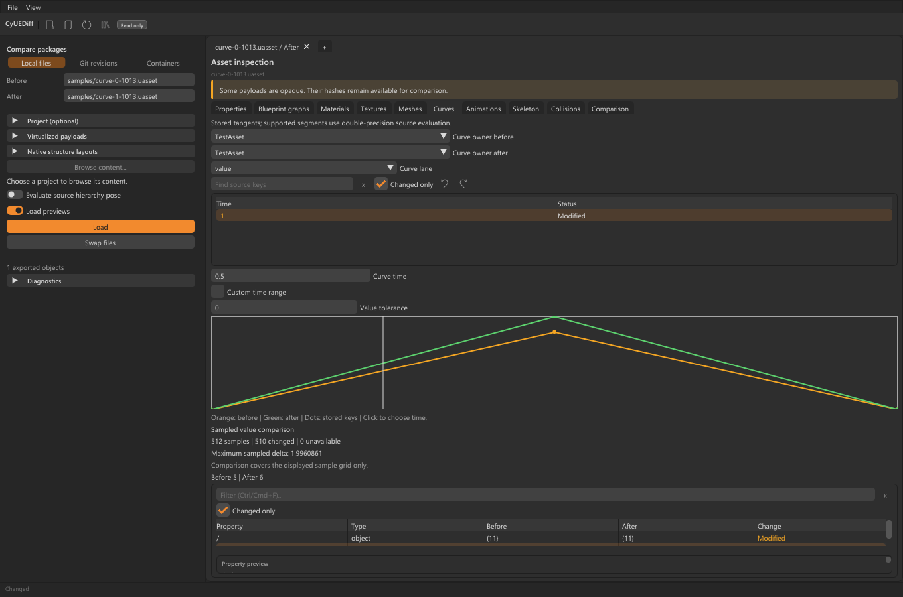
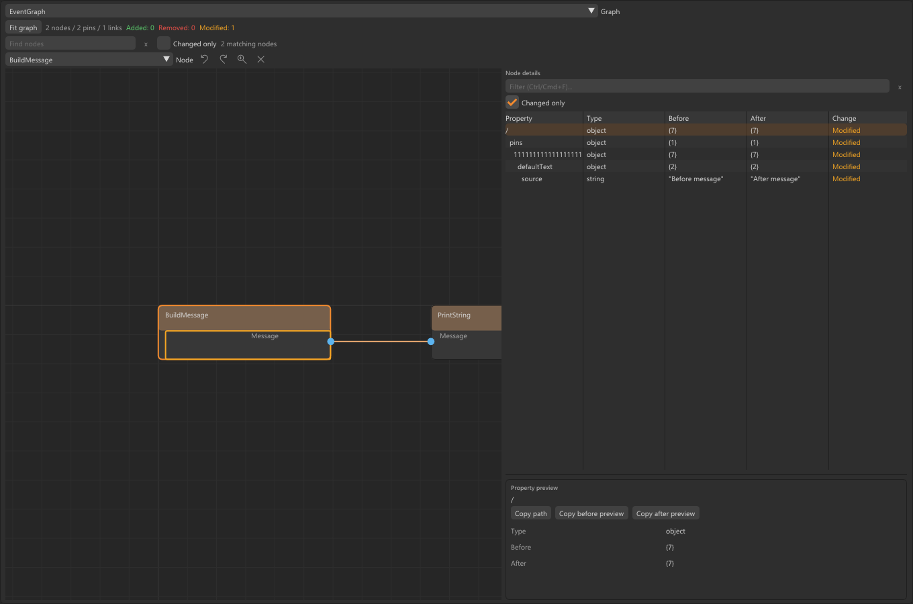
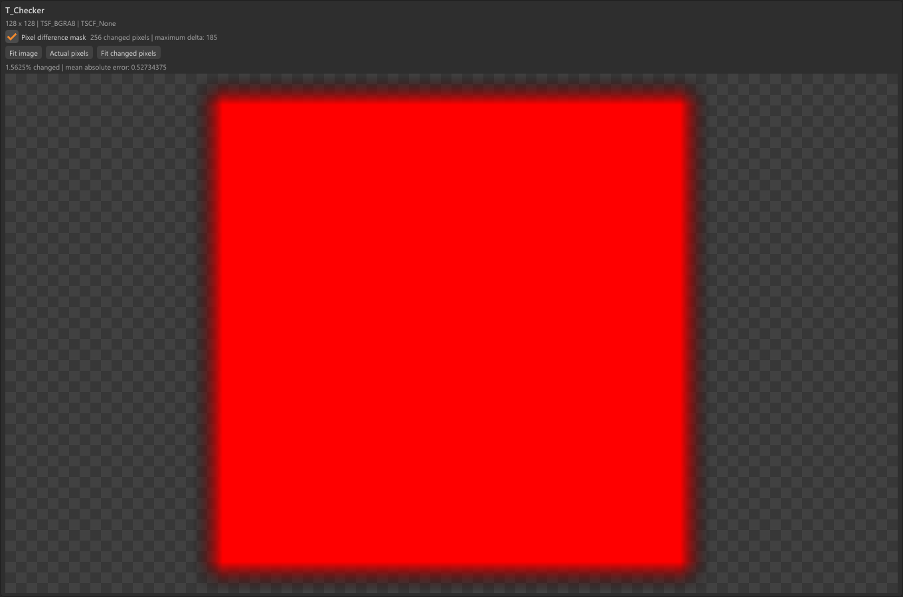

<table width="100%">
  <tr>
    <td width="300" align="left" valign="top">
      <a href="https://mrmybal.github.io/CyUEDIFF/?lang=en">Website</a><br>
      <a href="https://mrmybal.github.io/CyUEDIFF/guide.html?lang=en#start">Manual</a><br>
      <a href="https://github.com/MrMybal/CyUEDIFF">GitHub</a><br><br>
      <sub>README</sub><br>
      <a href="README.md">English</a> · <a href="README.fr.md">Français</a>
    </td>
    <td width="400" align="center" valign="middle">
      <a href="https://mrmybal.github.io/CyUEDIFF/?lang=en"></a>
    </td>
    <td width="300" align="right" valign="top">
      <p><sub>Application license</sub><br><a href="LICENSE"><strong>MIT</strong></a></p>
      <p><sub>Source version</sub><br><a href="VERSION.md"><strong>0.181.0</strong></a><br><strong>IN DEVELOPMENT</strong></p>
      <p><sub>Windows x64 desktop<br>No public application release yet</sub></p>
    </td>
  </tr>
</table>

<h1 align="center">CyUEDiff</h1>

Inspect Unreal Engine assets and understand what changed **without launching Unreal Editor**. CyUEDiff provides a Windows desktop application, a JSON command-line tool and a reusable C++17 reader for Unreal developers, technical artists and tool authors.

> **IN DEVELOPMENT · 0.181.0**
>
> This source version provides explicit, evolving format coverage. Unknown data keeps its diagnostics and byte fingerprints. Read the [version notes, supported platforms and known limitations](VERSION.md) before choosing a workflow.

[](site/assets/screenshots/overview-en.png)

## The application

Open an asset or compare two versions, then move between typed properties, Blueprint and material graphs, textures, source meshes, collisions, skeletons, animation keys and curves. Search for a property or node, inspect its stored values and follow highlighted changes. Each side can use its own project, engine and schema context.

Review loose `.uasset` / `.umap` packages and their companion files, local Git revisions with verified local LFS content, or supported Pak/IoStore members. Keep up to eight documents open and save explicit workspaces with supported selections, filters, navigation and panel proportions. English is the default; French is built in. Asset names and serialized values retain their original language.

<table>
  <tr>
    <td width="50%"><a href="site/assets/screenshots/blueprint-en.png"></a><br>Blueprint editor graph and selected node</td>
    <td width="50%"><a href="site/assets/screenshots/textures-en.png"></a><br>Texture source comparison and changed pixels</td>
  </tr>
</table>

These are real desktop and embeddable CyUI captures using original generated demonstration data. Click an image to open its full-size version. The [website](https://mrmybal.github.io/CyUEDIFF/?lang=en) presents additional views.

## Features

- **Readable asset differences:** searchable typed properties, stable object references, structured Blueprint pin texts, stored material graphs and instance parameters, with explicit partial/opaque coverage.
- **Source image and geometry review:** supported Texture2D LDR/HDR sources and mips, pixel/sample differences, modern MeshDescription wireframes, geometry differences and base-geometry OBJ export. Modern skeletal source bones, raw weight profiles and named morph deltas are fixture-validated.
- **Selected cooked Nanite inspection:** opt-in UE 5.3 Windows whole-resource positions, oriented topology, materials and stored shading attributes through Core/CLI/SDK, with scoped full-leaf surface differences and independent native shader references. Source-built EN/FR desktop review adds full-leaf/cluster wires, aligned corner attributes, stored hierarchy inspection and persistent independent contexts.
- **Stored motion data:** reference/retarget skeleton poses, sockets, supported local animation keys, explicitly Skeleton-bound source joint/socket origins and rich curves with supported weighted evaluation. These are inspections of stored source data.
- **Project and revision context:** separate before/after project and engine roots, local Git history/LFS reads, supported Pak 10/11 and IoStore TOC 3–5 members, cooked Zen tables and explicitly mapped USMAP properties.
- **Extensible readers:** bounded native decoder callbacks and declarative binary layouts with explicit version profiles; local virtualized editor payload stores require full raw BLAKE3 verification. Loading supports cooperative cancellation, progress and a verified package cache.
- **Reusable block deltas:** generate, compose and reconstruct file/block differences with SHA-256 verification. This is a separate binary reconstruction API; remote object hosting and synchronization are not implemented.

### Use the engine in another application

| Component | Purpose |
| --- | --- |
| `CyUEDiff::Core` | Package/container readers, snapshots, specialized differences and binary reconstruction; independent of Unreal Editor, Git and CyUI. |
| `CyUEDiff::Git` | Optional local revision and verified LFS-content access. Requires Git 2.45+. |
| `CyUEDiff::UI` | Separate embeddable CyUI property, graph, image and geometry views, built from source with the host. |
| `cyuediff` / `cyuediff_desktop` | JSON CLI and optional Windows desktop host. |

Link `CyUEDiff::Core` through `add_subdirectory`, or install the SDK and use `find_package(CyUEDiff CONFIG REQUIRED)`. Start with the [Core consumer](examples/consumer/) and the [source morph consumer](examples/mesh_morph_consumer/). The installed SDK supplies Core and the selected Git adapter; UI integration uses the source checkout. See [architecture](docs/ARCHITECTURE.md) and [UI integration](docs/UI.md).

---

## Installation

**No public application release is available yet.** Build from source using the instructions below. Core/CLI builds pass hosted CI on Windows 2022 and Ubuntu 24.04 with Git enabled and disabled. The desktop is verified locally on Windows x64 with Direct3D 11; no Linux or macOS desktop build is offered.

Windows builds using the default dynamic MSVC runtime need the matching Microsoft Visual C++ x64 runtime. Git features require a separate Git 2.45+ installation; loose-file inspection does not. Keep an extracted CPack archive together with its documentation and license notices. See [distribution and runtime requirements](docs/DISTRIBUTION.md).

After building, start `build-native/Release/cyuediff_desktop.exe`, choose **Local files**, select a before asset and optionally its after version, then load the document. Keep split companion files beside their packages. Use **View → Language → Français** or `--locale fr` for French; `--locale en` selects English explicitly.

## Source, build and required libraries

<details>
<summary>Requirements and build commands</summary>

Use CMake 3.20+, a C++17 compiler and Python 3 for helper scripts. The Windows desktop build uses MSVC 2022, the Windows SDK and a separate [CyUI checkout](https://github.com/MrMybal/CyUI). Core dependencies are vendored; the build does not download them.

```sh
git clone https://github.com/MrMybal/CyUEDIFF.git
cd CyUEDIFF
```

For Core/CLI on Windows or Linux:

```sh
cmake -S . -B build-core -DCMAKE_BUILD_TYPE=Release -DCYUEDIFF_BUILD_GIT=OFF
cmake --build build-core --config Release --parallel
ctest --test-dir build-core -C Release --output-on-failure
cmake --install build-core --config Release --prefix build-core/sdk
```

Set `CYUEDIFF_BUILD_GIT=ON` to include local Git integration. On Linux the executable is `build-core/cyuediff`; with the Windows Visual Studio generator it is `build-core/Release/cyuediff.exe`.

For the Windows desktop, obtain CyUI separately and replace the example checkout path:

```powershell
git clone https://github.com/MrMybal/CyUI.git D:/Libraries/CyUI
python scripts/build.py --desktop --cyui D:/Libraries/CyUI
build-native/Release/cyuediff_desktop.exe
```

The helper builds and runs the tests. For embeddable views without the desktop, omit `--desktop`. `--no-git` disables the optional Git adapter. An Oodle codec can be built only from an explicitly supplied, separately licensed Data SDK; it is not bundled or installed with Core. Selecting an engine root never launches Unreal or loads a codec automatically. See [codec integration](docs/CODECS.md).

</details>

<details>
<summary>CLI examples</summary>

```sh
cyuediff inspect Content/DA_Settings.uasset
cyuediff diff Before.uasset After.uasset --out changes.json
cyuediff image-diff BeforeTexture.uasset AfterTexture.uasset --heatmap mask.png
cyuediff mesh-diff BeforeMesh.uasset AfterMesh.uasset
cyuediff git-diff MyProject HEAD~1 HEAD Content/DA_Settings.uasset
```

Package differences do not automatically decode large image/geometry payloads; use the explicit specialized commands. Project/engine selection supplies context and paths. Unversioned properties and native formats require matching explicit schema/profile bindings. The reader does not modify Unreal assets. For package `diff`, exit codes are `0` for identical, `1` for changed and `2` for errors, incomplete inputs or unverifiable comparisons.

</details>

---

## License

**CyUEDiff's original code uses the [MIT license](LICENSE).** Copyright © 2026 CyUEDiff contributors. Third-party components retain their own terms. No Unreal Engine source code, binaries or project assets are redistributed.

### Third-party libraries

| Library · source | License · terms | Use / scope |
| --- | --- | --- |
| [nlohmann/json 3.12.0](https://github.com/nlohmann/json/tree/v3.12.0) | [MIT](https://github.com/nlohmann/json/blob/v3.12.0/LICENSE.MIT) | Vendored JSON representation for Core and reports. |
| [BLAKE3 1.8.2](https://github.com/BLAKE3-team/BLAKE3/tree/1.8.2) | [CC0-1.0 selected](https://github.com/BLAKE3-team/BLAKE3/blob/1.8.2/LICENSE_CC0) from CC0/Apache-2.0; both notices retained | Vendored portable C implementation for verified local virtualized editor payloads. |
| [stb_image / stb_image_write](https://github.com/nothings/stb/tree/d14d46f6b44456eb88beac58cba833a4135d4c89) | [MIT option of MIT/public-domain dual license](https://github.com/MrMybal/CyUEDIFF/blob/main/third_party/stb/LICENSE) | Vendored source image decoding and PNG output. |
| [CyUI](https://github.com/MrMybal/CyUI) | [MIT](https://github.com/MrMybal/CyUI/blob/main/LICENSE) | Optional host-provided views and Windows desktop interface; absent from Core-only builds. |
| [Dear ImGui](https://github.com/ocornut/imgui) | [MIT](https://github.com/MrMybal/CyUI/blob/main/third_party/imgui/LICENSE.txt) | Through the selected CyUI checkout; UI and Win32/Direct3D 11 backends. |
| [ImGui's bundled stb implementations](https://github.com/MrMybal/CyUI/tree/main/third_party/imgui) | [MIT or public domain, at the user's choice](https://github.com/MrMybal/CyUI/blob/main/THIRD_PARTY_NOTICES.md) | Font, packing and text-edit support compiled with ImGui. |
| [Lexilla, Scintilla headers and SciTE data](https://github.com/MrMybal/CyUI/blob/main/THIRD_PARTY_NOTICES.md) | [HPND-style permissive terms](https://github.com/MrMybal/CyUI/blob/main/third_party/lexilla/License.txt), with the corresponding header/data notices | CyUI Code dependency used by Diff: lexical engines, interfaces and syntax profiles; no Scintilla editor UI. |

This table is an index. Retain [THIRD_PARTY_NOTICES.md](THIRD_PARTY_NOTICES.md) and all license texts supplied with the exact build, including the host's CyUI notices. Windows system libraries and fonts come from the host OS. The optional Oodle adapter requires the caller's permitted Data SDK; no Oodle SDK or adapter binary is supplied with the repository/Core SDK.

## References and links

- [English manual](https://mrmybal.github.io/CyUEDIFF/guide.html?lang=en#start) · [Website](https://mrmybal.github.io/CyUEDIFF/?lang=en).
- [Version notes and limitations](VERSION.md) · [Detailed format coverage and roadmap](docs/ROADMAP.md).
- [Desktop guide](docs/DESKTOP.md) · [Visual review](docs/VISUAL_REVIEW.md) · [Git integration](docs/GIT.md).
- [Cooked Nanite geometry and scoped surface differences](docs/NANITE_GEOMETRY.md) · [Installed Core example](examples/cooked_nanite_consumer/README.md) · [Core comparison example](examples/cooked_nanite_comparison_consumer/README.md).
- [Source morphs](docs/MORPHS.md) · [Binary layouts](docs/BINARY_LAYOUTS.md) · [Block deltas](docs/BINARY_DELTA.md).
- [Source repository](https://github.com/MrMybal/CyUEDIFF) · [Releases](https://github.com/MrMybal/CyUEDIFF/releases) · [Issue tracker](https://github.com/MrMybal/CyUEDIFF/issues).
